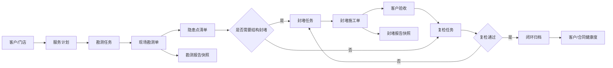

# 申汰 PCO 现场服务系统 PRD

## 0. 结论

现状不是“需要把两份 PDF 电子化”，而是“需要把一套已经运行在飞书多维表格里的连锁商超 PCO 业务，收敛成一个有数据约束、有状态机、有现场证据链的系统”。

系统的第一目标是把这条链路跑通：

`客户/门店 → 勘测任务 → 隐患点 → 结构封堵 → 验收 → 复检 → 报告归档`

第二目标才是合同、排班、物料、财务对账和经营分析。先闭环，再做宽。

## 1. 背景与证据

两份附件是飞书 Base `申汰PCO管理系统` 的打印结果：

- 现场勘测报告：`KC-2026-BG-128`，趣坊深圳水围店，2026-10-11，报告状态 `待整改`，风险 `高风险`，复检日期 2026-10-15（相对 2026-10-18 已逾期）。
- 结构(鼠患)封堵服务单：`STFD-2026-116`，宝山正大乐城，2026-09-06，验收结果 `已采纳`。

只读逆向盘点到的现有规模：

| 对象 | 数量 |
| --- | ---: |
| 客户项目 | 186 |
| 服务单 | 195 |
| 工程师 | 14 |
| 防治方案 | 7 |

现有服务单的风险分布：

| 风险等级 | 数量 |
| --- | ---: |
| 高风险 | 88 |
| 中风险 | 54 |
| 潜在风险 | 50 |
| 极高风险 | 1 |
| 未填写 | 2 |

现有数据质量问题：

- 186 个客户中，合同附件为 0。
- 只有 54 个客户关联了服务单，56 个客户关联了封堵报告。
- 服务单里 `服务内容与简介` 有 208 个多选项，`建议解决方案` 130 个，`风险点描述` 111 个，`处理方法` 66 个。
- 195 张服务单中，风险图片缺失 6 张、完工照片缺失 2 张、服务人员签字缺失 8 张、现场负责人签字缺失 9 张。

这些不是 UI 问题，是数据模型问题：长文本被当成了选项，隐患点没有独立身份，报告和现场证据无法稳定追溯。

## 2. 产品定位

**面向连锁商超/零售门店的有害生物防制现场服务与结构封堵闭环系统。**

一句话价值：

> 让每一处鼠迹、孔洞、封堵材料、施工照片、客户签字和复检结果，都能从同一张隐患点上查到，并自动生成可交付报告。

## 3. 用户与任务

| 角色 | 主要任务 | 关键诉求 |
| --- | --- | --- |
| 运营负责人 Eric | 看风险、看进度、看交付质量 | 高风险门店优先，逾期复检不遗漏 |
| 调度/项目主管 | 建单、排期、派工、催办 | 一张表看到今天谁去哪、还缺什么 |
| 现场工程师 | 勘测、拍照、登记隐患、施工、签字 | 手机能填、离线能存、少打字 |
| 质量/监理 | 审核报告、验收封堵、抽查 | 证据齐全、标准统一、可退回整改 |
| 客户门店负责人 | 看报告、确认整改、签字 | 报告清楚、责任边界明确、可扫码验证 |
| 财务/行政 | 合同、收入、外包付款、对账 | 服务单与收入/成本能对上 |

## 4. 目标与非目标

### 4.1 本期目标

1. 建立客户、门店、合同、服务计划的主数据。
2. 建立勘测单和封堵单两套现场流程，并让它们共享门店与隐患点。
3. 把隐患点、照片、处理方式、材料、签字、验收、复检做成结构化数据。
4. 从结构化数据生成两份可打印 A4 报告，并保留版本快照。
5. 提供高风险、逾期复检、证据缺失的运营看板。
6. 支持手机端离线采集和恢复同步。

### 4.2 非目标

- 本期不做完整财务系统；只保留服务单与合同金额、外包成本的关联字段。
- 本期不做客户自助小程序商城；先做只读报告链接和签字页。
- 本期不做 AI 自动识别虫害照片；先做模板推荐和表单校验。
- 本期不迁移所有飞书历史表；只迁移客户、服务单、封堵报告和方案库。

## 5. 核心流程

### 5.1 勘测单状态

`草稿 → 已提交 → 待整改 → 整改中 → 待复检 → 已闭环`

异常分支：`已退回`、`已作废`。

### 5.2 封堵单状态

`草稿 → 已排期 → 施工中 → 待验收 → 已验收 → 已闭环`

异常分支：`整改中`、`已作废`。

### 5.3 复检状态

`待排期 → 已排期 → 已完成 → 通过 / 不通过`

不通过时自动生成返工封堵任务，并保留原隐患点关联。

## 6. 功能需求

### 6.1 运营工作台

- 今日作业：勘测、封堵、复检、常规服务。
- 风险队列：极高/高风险、逾期复检、证据缺失、客户未签字。
- 关键指标：待整改数、今日作业数、逾期复检数、封堵闭环率。
- 高频隐患：按孔洞类型、区域、门店统计。
- 服务趋势：按月服务单量和闭环率。

### 6.2 客户与门店

- 客户名称、客户编号、类型、地区、地址、联系人、电话。
- 服务状态、服务频率、合同起止、每月金额、合同附件。
- 门店级风险分、最近服务、下次服务、未闭环隐患数。
- 一个客户可有多个门店；服务单必须落到门店。

### 6.3 勘测单

- 基础信息：报告编号、门店、日期、时间段、勘测人员、门店对接人、门店对接人电话。
- 勘测范围：收银区、仓储区、营业区域、货架顶部、货架底部、通道走廊等。
- 结构情况：无吊顶、梁柱裸露、墙体漏洞、管线穿墙缝隙、墙体开裂、门底缝隙等。
- 主要害虫：老鼠、蟑螂、蚊、蝇、白蚁、跳蚤、黄鼠狼等。
- 隐患点：区域、具体位置、类型、严重度、证据类型、照片、建议处理。
- 结构风险图片：结构漏洞、虫害痕迹、隐患点位实拍，支持批量上传，单张单据最多 100 张。
- 治理方案：综合治理、消杀作业、环境整改、长效预防。
- 结论：风险等级、复检日期、报告状态。
- 签字：勘测人员签字确认 + 客户代表签字，两张签名都在勘测人员手机上依次手写完成。
- 操作：保存草稿、提交审核、生成整改任务、生成报告、发起复检。

### 6.4 封堵单

- 关联勘测单和客户/门店。
- 服务类型、服务单位、服务日期、天气、施工负责人、现场监理人。
- 鼠害现状、密度、主要活动区域、封堵目的、漏洞类型。
- 封堵部位明细：每个部位一条记录，关联隐患点。
- 材料明细：材料、规格、单位、数量、批次。
- 封堵前/后照片：按部位成对归档。
- 验收标准、卫生改善建议、验收结果、建议频率、后续建议。
- 报告二维码与验证地址。
- 签字：封堵责任人签字 + 客户代表签字，两张签名都在封堵责任人手机上依次手写完成。

### 6.5 服务单

保留现有 PCO 服务单能力，但结构化：

- 服务类型、服务开始/结束、客户、项目地址、项目主管、服务人员。
- 风险等级、风险点描述、风险图片。
- 防治方案、处理方法、物料使用明细、数量、单位。
- 服务内容与简介（模板 + 自由文本）。
- 处理完工照片、现场负责人签字、服务人员签字。
- 任务标签、记录链接、二维码。

### 6.6 报告中心

- 模板：现场勘测报告、结构(鼠患)封堵服务单、PCO 服务单、整改复检报告。
- A4 预览、打印/PDF、版本历史。
- 报告编号规则、公司抬头、页脚、联系方式。
- 报告快照不可篡改；重新生成生成新版本。
- 二维码指向只读验证页，展示报告编号、客户、日期、签名状态和文件哈希。

### 6.7 复检与闭环

- 从勘测单或封堵单创建复检任务。
- 复检必须逐条确认隐患点状态：已封堵、未封堵、部分封堵、无法施工。
- 未通过自动生成返工任务。
- 闭环后更新门店风险分和下一次服务建议。

### 6.8 主数据

- 害虫种类、证据类型、结构隐患类型、区域、处理方式、材料、单位、服务类型、风险等级。
- 防治方案库：适用害虫、适用环境、使用药剂、使用方法、安全注意、效果评估、附件。
- 所有枚举支持启停用，不允许业务用户随意新增超级长文本选项。

### 6.9 权限与审计

- 角色：管理员、运营负责人、项目主管、工程师、质量监理、财务、客户只读。
- 关键动作写审计日志：提交、退回、验收、作废、签字、导出。
- 客户电话、合同、签名只对授权角色可见。

## 7. 关键字段

### 7.1 勘测单

| 字段 | 类型 | 必填 | 说明 |
| --- | --- | --- | --- |
| report_no | string | 是 | `KC-YYYY-BG-NNN` |
| site_id | uuid | 是 | 门店 |
| survey_date | date | 是 | 勘测日期 |
| time_range | string | 否 | 如 22:20-23:00 |
| surveyor_id | uuid | 是 | 勘测人员 |
| contact_name | string | 是 | 门店对接人 |
| contact_phone | string | 是 | 门店对接人电话，列表默认脱敏 |
| risk_photos | attachment[] | 是 | 结构风险图片，至少 1 张，最多 100 张 |
| scope | enum[] | 是 | 勘测范围 |
| structure_conditions | enum[] | 是 | 结构情况 |
| pest_species | enum[] | 是 | 主要害虫 |
| evidence_types | enum[] | 是 | 虫害痕迹证据 |
| integrated_plan | text | 是 | 综合治理方案 |
| treatment_plan | text | 是 | 消杀作业治理 |
| environment_advice | text | 是 | 环境整改建议 |
| long_term_prevention | text | 是 | 长效预防措施 |
| risk_level | enum | 是 | 低/中/高/极高 |
| recheck_date | date | 是 | 复检日期 |
| status | enum | 是 | 状态机 |
| surveyor_signature | signature | 是 | 勘测人员手写签字 |
| customer_signature | signature | 是 | 客户代表手写签字 |

### 7.2 封堵单

| 字段 | 类型 | 必填 | 说明 |
| --- | --- | --- | --- |
| report_no | string | 是 | `STFD-YYYY-NNN` |
| inspection_id | uuid | 否 | 来源勘测单 |
| site_id | uuid | 是 | 门店 |
| service_type | enum | 是 | 首次/返工/维护 |
| service_date | date | 是 | 服务日期 |
| weather | string | 否 | 天气 |
| leader_id | uuid | 是 | 施工负责人 |
| supervisor_id | uuid | 否 | 现场监理 |
| rodent_species | enum | 是 | 鼠种 |
| density | enum | 是 | 低/中/高 |
| activity_areas | enum[] | 是 | 活动区域 |
| purpose | string | 是 | 封堵目的 |
| hole_types | enum[] | 是 | 漏洞类型 |
| acceptance_result | enum | 是 | 待验收/已采纳/需整改 |
| frequency | enum | 否 | 建议服务频率 |
| status | enum | 是 | 状态机 |
| responsible_signature | signature | 是 | 封堵责任人手写签字 |
| customer_signature | signature | 是 | 客户代表手写签字 |

### 7.3 隐患点

| 字段 | 类型 | 必填 | 说明 |
| --- | --- | --- | --- |
| inspection_id | uuid | 是 | 来源勘测单 |
| area | enum | 是 | 区域 |
| location | string | 是 | 具体位置 |
| hazard_type | enum | 是 | 孔洞/缝隙/破损/缺失 |
| severity | enum | 是 | 低/中/高/极高 |
| evidence_type | enum[] | 是 | 鼠迹/鼠粪/咬痕/油脂印等 |
| photo_ids | uuid[] | 是 | 至少一张 |
| recommendation | text | 否 | 建议处理 |
| status | enum | 是 | 待整改/整改中/已封堵/无法施工 |

## 8. MVP 范围

### Phase 1：闭环

- 客户/门店/合同基础信息。
- 勘测单、隐患点、封堵单、复检。
- 报告 A4 预览与 PDF。
- 手机端拍照、签字、离线草稿。
- 风险队列与逾期提醒。

### Phase 2：经营

- 防治方案库、物料库存、外包付款、收入对账。
- 客户健康度、续约提醒、服务毛利。

### Phase 3：规模化

- 客户只读门户/小程序、扫码验真。
- 多组织/多分公司。
- 智能模板推荐、照片质量检查、异常风险提示。

## 9. 验收标准

1. 新建一个门店勘测单，能登记至少 3 个隐患点，每个隐患点有照片和严重度。
2. 从勘测单生成封堵任务，封堵单能引用原隐患点并记录材料。
3. 封堵后上传前后照片，发起客户签字，签字后状态变为 `待验收`。
4. 验收通过后生成复检任务；复检不通过能自动生成返工任务。
5. 两份报告都能在 A4 预览中完整展示，打印不截断，页码和页脚正确。
6. 报告生成后数据修改不会改变已生成版本，只能生成新版本。
7. 手机端断网可保存草稿，恢复网络后同步且不重复。
8. 工作台能筛出所有逾期复检和高风险未闭环门店。
9. 权限验证：工程师不能看到其他工程师的客户电话和合同附件。
10. 审计日志能回答“谁在什么时候改了哪个隐患点/签字/报告”。

## 10. 指标

- 高风险隐患 7 天整改率。
- 封堵一次验收通过率。
- 逾期复检数。
- 报告一次生成成功率。
- 服务单证据完整率（照片、材料、双签字）。
- 客户合同附件覆盖率。
- 单店月度服务成本与服务收入差异。

## 11. 风险与假设

- 现有飞书 Base 的封堵表对 guest 不可读，封堵字段根据 PDF 与客户表关联推断；正式迁移前需要登录导出。
- 现有服务单的 `服务内容与简介` 等字段是多选长文本，迁移时要拆成模板、标签和自由文本，不能原样复制。
- 现场网络不稳定，离线同步是硬需求，不是增强项。
- 客户签字涉及法律证据，需要保留签名图片、时间、设备、IP、报告哈希。
- 如果业务仍强依赖飞书协作，可先做“结构化系统 + 飞书通知/导出”的混合过渡。

