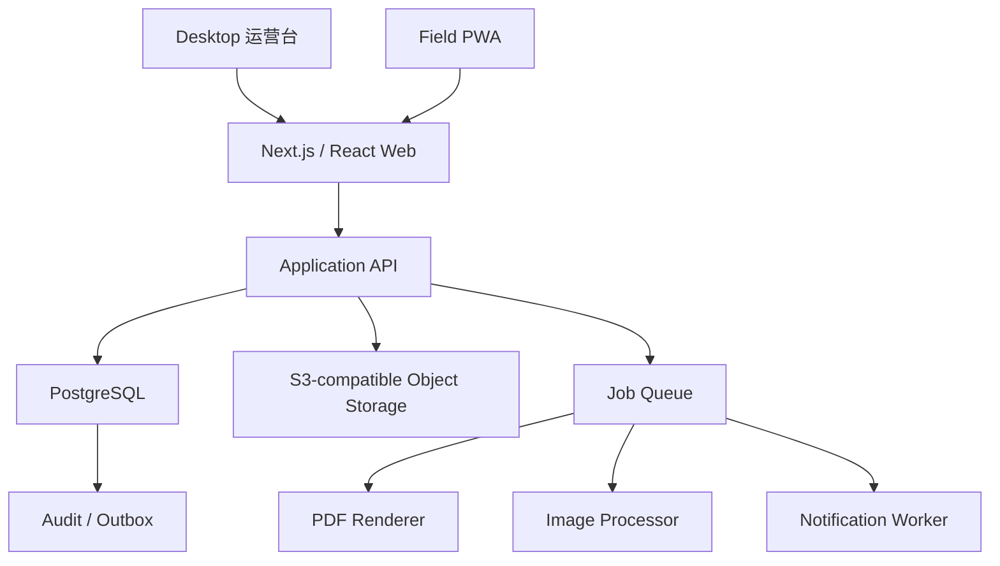
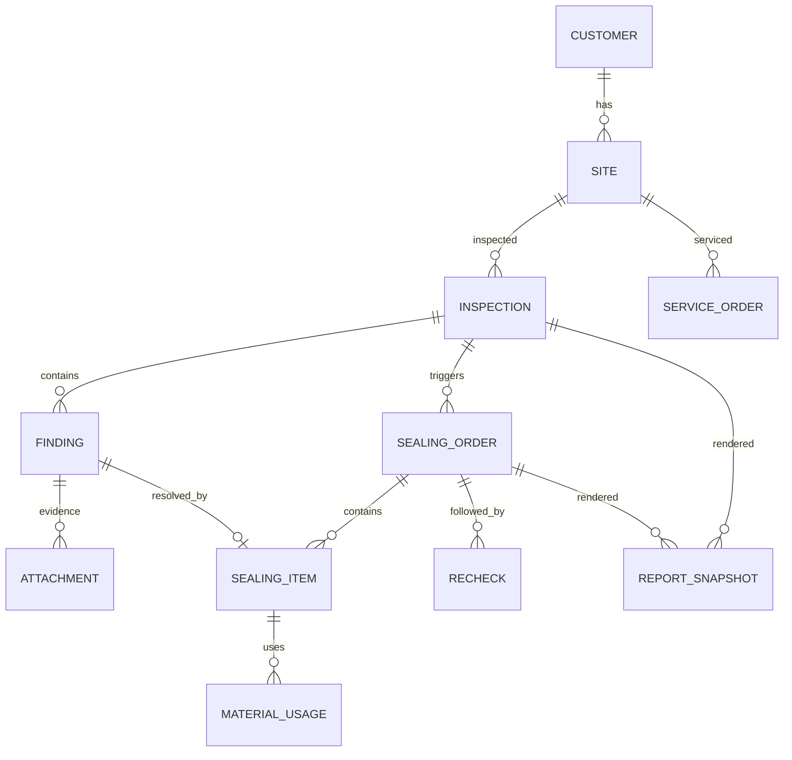
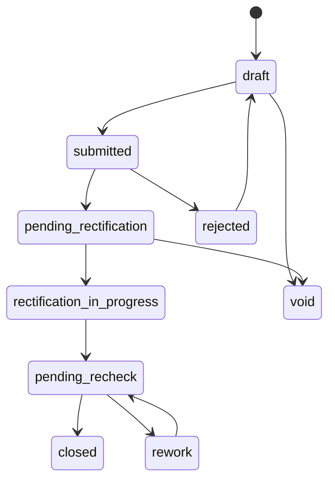
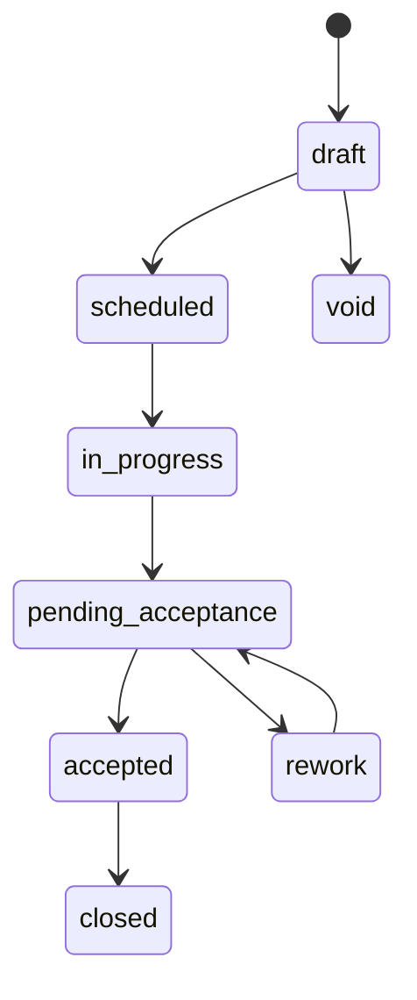

# 申汰 PCO 现场服务系统 Tech Spec

## 1. 架构结论

采用**模块化单体 + 响应式 Web/PWA + 异步任务**，不做微服务。

理由：

- 当前业务规模约 200 家门店、200 张服务单/年量级，单体足够。
- 现场离线、报告生成、文件处理需要可靠的后台任务，但不需要独立服务集群。
- 一名独立开发者维护，部署和排障成本必须低。
- 领域边界清晰后，未来可以按模块拆出，不需要一开始就拆。

## 2. 技术栈

| 层 | 选型 | 说明 |
| --- | --- | --- |
| Web | Next.js + React + TypeScript | 运营台、报告中心、客户门户共用 |
| Field | 同一代码库的 PWA | 手机拍照、离线草稿、签字 |
| API | Next.js Route Handlers 或 NestJS | 领域服务保持模块化 |
| DB | PostgreSQL 16+ | 关系、约束、JSONB、全文检索 |
| ORM | Prisma | 类型安全、迁移可审查 |
| Files | S3 兼容对象存储 | 照片、合同、PDF、签名 |
| Jobs | PostgreSQL 队列（如 pg-boss） | 少一个 Redis 依赖 |
| PDF | Playwright/Chromium + HTML/CSS A4 | 与前端预览共用模板 |
| Image | sharp | 缩略图、EXIF 清理、尺寸校验 |
| Auth | 手机号 OTP + 管理端密码/SSO | 现场人员优先手机号 |
| Observability | OpenTelemetry + 结构化日志 | 任务、同步、报告失败可追踪 |
| Deploy | Docker + 托管 PostgreSQL + 对象存储 | 阿里云/腾讯云均可 |

原型使用 Vite + React，生产实现迁移到 Next.js 不影响领域模型和页面结构。

## 3. 模块边界

| 模块 | 职责 | 不负责 |
| --- | --- | --- |
| Identity | 用户、角色、权限、会话 | 客户联系人 |
| Customer | 客户、门店、联系人、合同 | 服务执行 |
| Planning | 服务计划、任务、排期、派工 | 现场表单 |
| Inspection | 勘测单、隐患点、证据、结论 | 封堵施工 |
| Sealing | 封堵单、部位、材料、验收 | 常规服务单 |
| Service | PCO 常规服务单 | 合同收款 |
| Recheck | 复检、返工、闭环 | 报告排版 |
| Reporting | 模板、快照、PDF、二维码 | 业务状态变更 |
| Files | 上传、签名、缩略图、签名证据 | 业务权限判断 |
| Finance | 合同金额、收入、外包成本、对账 | 总账 |
| Audit | 审计日志、导出记录 | 业务数据本身 |

## 4. 领域模型

详见 [docs/02-data-model.md](docs/02-data-model.md)。

核心关系：

### 4.1 关键约束

- `finding.site_id` 必须与 `inspection.site_id` 一致。
- `sealing_item.finding_id` 必须属于同一门店。
- `report_snapshot` 生成后不可更新，只能新建版本。
- `signature` 必须绑定 `report_snapshot_id` 或业务单据 ID，并记录签名人、时间、设备、IP、文件哈希。
- 附件必须绑定业务实体和附件类型，不允许游离文件。
- 所有业务表带 `organization_id`，为未来多组织隔离预留。

### 4.2 状态机

封堵单：

## 5. API 设计

详见 [docs/03-api-contract.md](docs/03-api-contract.md)。

约定：

- REST + JSON，路径以 `/api/v1` 开头。
- 所有写操作支持 `Idempotency-Key`。
- 分页使用 `cursor`，列表筛选使用显式 query 参数。
- 错误统一返回 `code`、`message`、`details`、`request_id`。
- 附件使用预签名上传，业务接口只接收 `attachment_id`。
- 报告生成是异步任务，返回 `job_id`，前端轮询或订阅。

## 6. 离线与同步

### 6.1 现场端

- IndexedDB 保存草稿、照片队列、签字队列。
- 每条草稿使用客户端生成的 UUID，服务端以其作为幂等键。
- 表单编辑使用 `version` 乐观锁；冲突时保留本地副本并提示合并。
- 照片先本地压缩到合适尺寸，再排队上传；原图保留在设备直到成功。
- 网络恢复后按“业务单据 → 照片 → 签字 → 提交”顺序同步。

### 6.2 同步规则

- 服务端是已提交状态的唯一事实来源。
- 未提交草稿允许覆盖，但记录 `client_updated_at`。
- 已提交单据只允许通过明确的状态动作修改，不允许直接 PATCH 全量覆盖。
- 同步失败按指数退避重试，超过阈值进入“待人工处理”。

## 7. 报告生成

1. 业务单据进入可报告状态。
2. 服务端组装 `ReportSnapshot`：模板版本、字段快照、照片清单、签名清单。
3. 渲染 HTML/CSS A4 模板。
4. 使用 Playwright 生成 PDF。
5. 计算 PDF SHA-256，上传对象存储。
6. 生成二维码，指向 `/verify/reports/{token}`。
7. 写入 `report_snapshot` 与审计日志。

报告模板与预览使用同一套 HTML/CSS，避免“预览对了、PDF 不对”。

### 7.1 手写签字

- 勘测单：勘测人员在手机上手写确认，然后把同一台手机交给客户代表签第二笔。
- 封堵单：封堵责任人在手机上手写确认，然后把同一台手机交给客户代表签第二笔。
- 前端使用 canvas + pointer events，兼容触控和鼠标；保存 PNG、签字时间、签字人和设备信息。
- 两个签字都完成后才允许锁定报告；签字图片进入报告快照，并计算文件哈希。

### 7.2 报告编号

- 勘测：`KC-{YYYY}-BG-{seq}`。
- 封堵：`STFD-{YYYY}-{seq}`。
- PCO 服务：`STFW-{YYYY}-{seq}`。

序号按组织+年度+类型生成，数据库唯一约束兜底。

## 8. 权限

| 角色 | 客户 | 勘测 | 封堵 | 服务单 | 报告 | 财务 |
| --- | --- | --- | --- | --- | --- | --- |
| 管理员 | 全部 | 全部 | 全部 | 全部 | 全部 | 全部 |
| 运营负责人 | 全部 | 全部 | 全部 | 全部 | 全部 | 只读 |
| 项目主管 | 负责客户 | 负责门店 | 负责门店 | 负责门店 | 生成/查看 | 无 |
| 工程师 | 只读负责门店 | 自己任务 | 自己任务 | 自己任务 | 查看自己 | 无 |
| 质量监理 | 负责门店 | 审核 | 验收 | 抽查 | 审核/导出 | 无 |
| 财务 | 合同金额 | 只读 | 只读 | 只读 | 只读 | 全部 |
| 客户只读 | 自己门店 | 已发布 | 已发布 | 已发布 | 只读 | 无 |

权限在服务端校验，前端隐藏按钮只作为体验优化。

### 8.1 登录与会话

- 管理端使用手机号 + 密码登录；密码只保存 Argon2id/bcrypt 哈希，不保存明文。
- 生产环境增加登录限流、失败次数锁定、可选 TOTP，并记录登录审计。
- 现场人员可继续使用手机号 OTP；客户只读访问使用短时效签名链接。
- 会话使用 HttpOnly、Secure、SameSite Cookie；设置空闲超时和主动退出。
- 原型登录只用于界面验证，不能作为生产认证实现。

## 9. 安全

- 所有上传校验 MIME、扩展名、尺寸和文件头；拒绝可执行文件。
- 图片处理时移除 EXIF 中的定位等非必要信息。
- 附件通过短时效签名 URL 访问，不暴露对象存储路径。
- 手机号、合同、签名属于敏感数据，列表默认脱敏。
- 审计日志不可由业务用户修改。
- 报告验证页只展示必要字段，不展示完整客户联系方式和内部备注。
- 备份加密，定期恢复演练。
- 满足最小收集、明确用途、保留期限和删除流程。

## 10. 部署

### 10.1 初期

- 1 个 Web/API 容器。
- 1 个 Worker 容器（报告、图片、通知）。
- 托管 PostgreSQL。
- S3 兼容对象存储 + CDN。
- 反向代理 + TLS。

### 10.2 备份

- PostgreSQL 每日全量 + WAL 归档。
- 对象存储版本化。
- 报告快照和签名文件单独保留。
- 每季度做一次恢复演练。

## 11. 测试

- 单元测试：状态机、编号生成、权限、报告快照。
- 集成测试：勘测→封堵→验收→复检主链路。
- 合同测试：API 响应结构与前端类型。
- E2E：Playwright 覆盖桌面和手机主流程。
- 视觉检查：A4 报告、移动端表单、文本溢出、签字区域。
- 离线测试：断网、重复提交、照片重传、版本冲突。
- 安全测试：越权访问、签名 URL 过期、上传恶意文件。

## 12. 迁移

1. 从飞书导出四张主表 CSV/Excel：客户、服务单、工程师、方案库。
2. 以客户编号/服务单编号建立外部 ID 映射。
3. 清洗多选长文本：拆为模板、标签、自由文本。
4. 先迁移客户和门店，再迁移服务单，最后迁移封堵报告。
5. 对缺失合同、缺失签字、缺失照片生成“数据待补”任务。
6. 迁移后做抽样核对：字段数、记录数、金额合计、报告抽样。

迁移脚本必须可重复执行，使用外部 ID 幂等 upsert。

## 13. 分期

| 阶段 | 交付 |
| --- | --- |
| Phase 1 | 主数据、勘测、封堵、复检、报告、工作台、PWA |
| Phase 2 | 方案库、物料库存、财务对账、客户健康度 |
| Phase 3 | 客户门户、扫码验真、多组织、智能辅助 |

