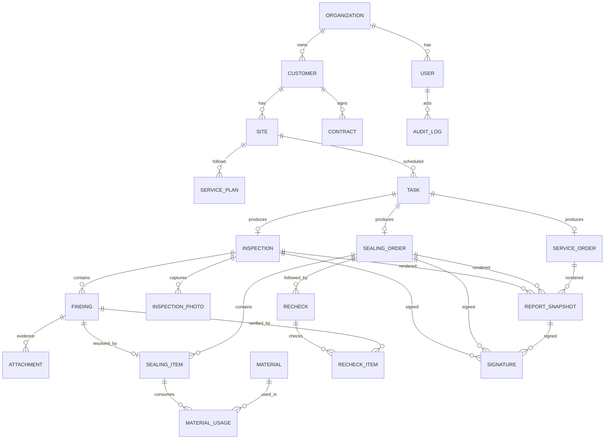

# 数据模型

## 1. ERD

## 2. 实体

### 2.1 Organization / User / Role

| 表 | 关键字段 |
| --- | --- |
| organization | id, name, code, timezone, created_at |
| user | id, organization_id, name, phone_masked, email, status |
| role | id, code, name |
| user_role | user_id, role_id, scope_type, scope_id |
| role_permission | role_id, module_key, action, allowed |
| user_scope | user_id, scope_type, scope_id |

`role_permission.action`：`view`、`create`、`edit`、`approve`、`export`。敏感操作使用独立的 `sensitive_permission` 表或带 `is_sensitive` 标记的权限项。

### 2.2 Customer / Site / Contract

| 表 | 关键字段 |
| --- | --- |
| customer | id, organization_id, code, name, type, region, status, notes |
| site | id, customer_id, code, name, address, contact_name, contact_phone_encrypted, region, risk_level |
| contract | id, customer_id, contract_no, start_date, end_date, monthly_amount, attachment_id, status |
| service_plan | id, site_id, frequency, next_service_at, active, notes |

约束：

- `customer.code` 在组织内唯一。
- `site.code` 在客户内唯一。
- 合同起止日期有效，结束日期不得早于开始日期。

### 2.3 Task

| 字段 | 说明 |
| --- | --- |
| id | UUID |
| type | survey / sealing / service / recheck |
| site_id | 门店 |
| assignee_id | 负责人 |
| scheduled_at | 计划时间 |
| status | todo / in_progress / blocked / done / cancelled |
| priority | low / normal / high / urgent |
| source_type | 任务来源 |
| source_id | 来源单据 ID |

### 2.4 Inspection / Finding

| 表 | 关键字段 |
| --- | --- |
| inspection | id, report_no, site_id, survey_date, time_range, surveyor_id, contact_name, contact_phone_encrypted, scope, structure_conditions, pest_species, evidence_types, integrated_plan, treatment_plan, environment_advice, long_term_prevention, risk_level, recheck_date, status, version |
| finding | id, inspection_id, site_id, area, location, hazard_type, severity, evidence_types, recommendation, status, sort_order |
| inspection_photo | id, inspection_id, attachment_id, photo_type, caption, sort_order |

`inspection_photo.photo_type`：`structure_risk`、`pest_evidence`、`environment`。

勘测单的结构风险图片最多 100 张，在服务层事务中校验；封堵单的前后照片属于 `sealing_item`，不要混入勘测单。

### 2.5 Sealing

| 表 | 关键字段 |
| --- | --- |
| sealing_order | id, report_no, inspection_id, site_id, service_type, service_date, weather, leader_id, supervisor_id, rodent_species, density, activity_areas, purpose, hole_types, acceptance_criteria, hygiene_advice, acceptance_result, frequency, follow_up_advice, status, version |
| sealing_item | id, sealing_order_id, finding_id, area, location, hole_type, material_summary, before_photo_id, after_photo_id, result, notes |
| material | id, organization_id, name, spec, unit, sku, active |
| material_usage | id, sealing_item_id, material_id, quantity, unit, batch_no, notes |

### 2.6 Service Order

| 表 | 关键字段 |
| --- | --- |
| service_order | id, report_no, site_id, service_type, start_at, end_at, project_manager_id, technician_id, risk_level, plan_id, content, notes, status |
| service_risk_point | id, service_order_id, area, description, attachment_id, treatment, sort_order |
| service_material_usage | id, service_order_id, material_id, quantity, unit, notes |

`content` 使用模板 + 自由文本，不再使用 208 个多选项。

### 2.7 Recheck

| 表 | 关键字段 |
| --- | --- |
| recheck | id, inspection_id, sealing_order_id, scheduled_at, completed_at, result, inspector_id, notes |
| recheck_item | id, recheck_id, finding_id, result, photo_id, notes |

`recheck_item.result`：`passed`、`failed`、`not_applicable`、`blocked`。

### 2.8 Report / Signature / Attachment

| 表 | 关键字段 |
| --- | --- |
| report_template | id, code, name, version, html, css, active |
| report_snapshot | id, template_id, template_version, business_type, business_id, report_no, data_json, pdf_attachment_id, pdf_sha256, qr_token, generated_by, generated_at |
| signature | id, business_type, business_id, report_snapshot_id, signer_name, signer_role, signature_attachment_id, signed_at, ip, user_agent, image_sha256 |

签字角色：

- 勘测单：`surveyor`（勘测人员）、`customer_rep`（客户代表）。
- 封堵单：`sealing_responsible`（封堵责任人）、`customer_rep`（客户代表）。
- 两类单据都必须在同一台执行手机上依次完成两笔签名；签字图片通过 `attachment` 存储。
| attachment | id, organization_id, storage_key, original_name, mime_type, size, sha256, width, height, created_by, created_at |

### 2.9 Audit

| 表 | 关键字段 |
| --- | --- |
| audit_log | id, organization_id, actor_id, action, entity_type, entity_id, before_json, after_json, ip, user_agent, created_at |

## 3. 枚举

### 3.1 风险

- `low`
- `medium`
- `high`
- `critical`

### 3.2 勘测范围

- `checkout`
- `storage`
- `sales_area`
- `shelf_top`
- `shelf_bottom`
- `corridor`
- `kitchen`
- `ceiling`
- `utility_room`

### 3.3 结构情况

- `no_ceiling`
- `exposed_beam`
- `wall_opening`
- `pipe_penetration`
- `wall_crack`
- `door_gap`
- `window_gap`
- `missing_partition`
- `damaged_screen`

### 3.4 害虫

- `rat`
- `mouse`
- `cockroach`
- `mosquito`
- `fly`
- `termite`
- `flea`
- `bedbug`
- `weasel`
- `other`

### 3.5 隐患类型

- `wall_hole`
- `pipe_gap`
- `structural_crack`
- `door_gap`
- `ceiling_gap`
- `shelf_gap`
- `missing_net`
- `damaged_seal`
- `other`

### 3.6 封堵材料

- `aluminum_panel`
- `fire_clay`
- `sealant`
- `steel_wool`
- `cement`
- `rodent_mesh`
- `metal_screen`
- `sealing_strip`
- `other`

## 4. 索引

- `inspection(site_id, survey_date desc)`
- `inspection(status, recheck_date)`
- `finding(inspection_id, sort_order)`
- `inspection_photo(inspection_id, sort_order)`
- `sealing_order(site_id, service_date desc)`
- `sealing_item(sealing_order_id, sort_order)`
- `service_order(site_id, start_at desc)`
- `recheck(scheduled_at, result)`
- `report_snapshot(business_type, business_id, generated_at desc)`
- `audit_log(entity_type, entity_id, created_at desc)`

## 5. 飞书迁移映射

| 飞书类型 | 迁移策略 |
| --- | --- |
| 文本 (1) | `text` 或 `varchar` |
| 数字 (2) | `numeric` / `integer` |
| 单选 (3) | 枚举表或 `enum` |
| 多选 (4) | 主数据关联 + 自由文本；禁止直接变成超大枚举 |
| 日期 (5) | `timestamptz` |
| 附件 (17) | `attachment` + 业务关联表 |
| 查找引用 (19) | 服务端 JOIN / 视图，不落库为事实 |
| 公式 (20) | 计算列或物化视图 |
| 双向关联 (21) | 外键 |
| 创建时间 (1001) | `created_at` |
| 自动编号 (1005) | 业务编号序列 |

### 5.1 服务单迁移

- `客户名称`、`客户编号`、`项目地址` → 客户/门店匹配。
- `服务人员`、`项目主管`、`员工编号` → 用户/工程师。
- `风险图片`、`处理完工照片`、`服务人员签字`、`现场负责人签字` → 附件/签名。
- `物料使用`、`数量`、`单位` → 物料使用明细；需要按行拆分。
- `服务内容与简介`、`风险点描述`、`建议解决方案`、`处理方法` → 拆为模板段落、风险点、建议项、处理方式标签和自由文本。

### 5.2 客户迁移

- `客户编号` → `customer.code`。
- `客户名称` × `详细地址` → `customer` + `site`。
- `服务频率`、`服务状态`、`客户类型` → 枚举。
- `合同附件` → `contract.attachment_id`；当前为空，迁移后生成补录任务。
- `服务单`、`鼠洞封堵报告`、`封堵跟进` → 关联关系。

